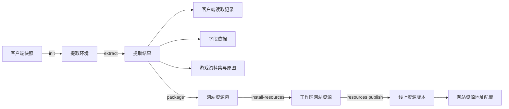

# 客户端资源提取

本工具从客户端快照提取资料、打包并安装网站资源。概念定义见[领域术语表](../../GLOSSARY.md#提取打包与本地安装)，维护决策及版本调查见[提取原理](docs/extraction-method.md)。

## 首次配置

先按[根 README](../../README.md#本地开发)安装依赖，并按其中的环境配置说明，在根目录 `.env` 中填写共享数据目录的绝对路径 `LOOMIX_DATA_ROOT`。准备支持平台上的客户端文件；支持平台以 [AnimeStudio 平台配置](src/client/anime-studio/config.ts)为准，首次准备工具需要网络、Git 与归档解压工具。

在仓库根目录导入客户端。来源应指向包含 `config.ini` 和客户端数据目录的文件夹，可使用仓库外的绝对路径。

```sh
vp run @loomix/extraction#client -- import --source /path/to/client
```

导入会校验并冻结客户端，打印完整快照 ID 和可读的版本目录。`init` 和 `refresh` 默认使用唯一符合当前版本配置的快照。无匹配时导入所需版本。有多个匹配时向该次命令传入 `--snapshot <完整 ID>`，显式指定的版本也必须匹配。客户端更新时先确认版本适配，再导入新客户端。参见[提取原理](docs/extraction-method.md#客户端更新与调查)。

## 提取、打包与本地安装

以观星露营地为例，客户端读取记录保留玩法表中的座椅数量 3 和显示表中的 2。游戏资料集保留两种有不同含义的数量，字段依据记录各自来源。网站资源包把资料和布景配图一起交给网站，图片索引用于按用途找到配图文件。[业务确认与调查](docs/business-investigation.md#小栖地)



日常更新网站资源：

```sh
vp run @loomix/extraction#refresh
# 将 refresh 打印的 resource-package-id 填入下面的命令
vp run @loomix/extraction#verify --resource-package <resource-package-id>
vp run @loomix/extraction#install-resources --resource-package <resource-package-id>
```

`refresh` 依次准备提取环境、提取数据及原图、生成资源包。`verify` 核对实际客户端及整条产物链。`install-resources` 校验资源包后替换当前 worktree 的 `resources/website/`。已有共享资源包时，配置共享数据目录后可直接安装。

花卉杂交配方在[人工维护 JSON](data/external/flower-hybridization.json)中更新。换版时核对目标版本、系列归属、花朵 ID 及配方适用性。复核期间可使用绑定目标版本且配方数组为空的输入。更新后运行 `refresh` 和 `verify`，再安装资源。版本不匹配、缺少文件或无效配方会中止提取。

需要分阶段运行时，从帮助查看入口与参数：

```sh
vp run @loomix/extraction#refresh -- --help
```

帮助可在未准备工具时运行。阶段命令打印完整 ID 和目录路径。`--environment`、`--extraction` 和 `--resource-package` 接受对应阶段的完整 ID 或准确的目录名。`--snapshot` 使用完整快照 ID。`client import --source` 的相对路径以仓库根目录为准。[CLI](src/cli.ts) · [共享数据契约](../../packages/schema/README.md#资料集图片与发布)

## 输入、缓存与产物

同机 worktree 共享 `LOOMIX_DATA_ROOT` 下的客户端、工具缓存和版本化产物；本地网站资源与临时调查文件各自独立。

| 位置                          | 用途                                 |
| ----------------------------- | ------------------------------------ |
| 共享根 `clients/`             | 按客户端版本和哈希前缀命名的只读快照 |
| 共享根 `cache/`               | 工具准备、昂贵批次恢复与失败诊断     |
| 共享根 `artifacts/`           | 封存的提取环境、提取结果与资源包     |
| worktree `resources/website/` | 当前网站读取的本地资源               |
| worktree `var/scratch/`       | 临时调查文件                         |

`artifacts/` 下按阶段分目录。提取环境与提取结果沿用客户端快照的版本标签，加上各自的短哈希，例如 `0.95.2-d1449213-r1391927-m5662883--2336736f9d09`。网站资源包在版本标签末尾加网站资源格式号，如 `-f16`。完整 SHA-256 保存在阶段清单中，用于验证和关联上游。

具体输出以各阶段清单的 `outputs` 为准。调查时从 `client-read-records.json` 查读取记录、排除项与候选，从 `field-evidence.json` 查最终字段依据。[提取原理](docs/extraction-method.md#按任务定位实现)

每个代码版本仅接受对应的提取阶段格式。遇到阶段清单版本不受支持时，使用匹配客户端快照运行 `refresh`，再使用新的阶段 ID 打包、验收或安装。客户端资源包的来源路径相对于该客户端快照根目录。

从旧客户端目录布局升级时，先准备共享根之外的独立客户端来源，并停止共用该数据根的提取任务。清除 `LOOMIX_DATA_ROOT` 下的 `client/`、`clients/`、`selections/`、`artifacts/` 与 `cache/`，再重新导入、提取和验收。此操作会删除旧快照、产物及工具缓存，共用该目录的 worktree 需要升级后再运行提取。

如果只有阶段目录仍使用纯哈希命名，可在停止共用该数据根的提取任务后按上述规则重命名现有封存目录。保留清单原始字节，改名后从资源包运行 `verify` 核对整条链路。也可删除旧产物后运行 `refresh` 重建。

升级网站资源格式时，停止本工作区的安装和发布任务。`install-resources` 会整体替换 `resources/website/`，无需预先备份旧目录；受跟踪的 `.gitkeep` 占位会保留。若需回滚，重新安装保留的旧资源包。

## 故障恢复与清理

失败后先查看命令错误及日志：工具准备日志在 `cache/anime-studio/logs/`，提取诊断在 `cache/failures/`，批次诊断在 `cache/decode/failures/` 和 `cache/originals/failures/`。修复原因后重跑；已完成且通过复验的昂贵批次可复用，不必先清空缓存。工具版本或下载失效时检查 [AnimeStudio 配置](src/client/anime-studio/config.ts)，显式更新固定版本与摘要，不自动跟随最新构建。

`install-resources` 替换本地资源失败时恢复旧目录。切换期间，本地资源可能短暂不可用。线上更新步骤见[CI/CD 与部署](../../DEPLOYMENT.md#资源更新流程)。

无运行任务时再清理失败的暂存目录、缓存或不再使用的产物。保留各 worktree 在用和计划用于回滚的资源包及其上游完整链。删除恢复缓存不会影响已有封存提取结果。如果构建提示目录哈希冲突或无法确认目录身份，先检查清单并移走占用目录，再重试。客户端、共享缓存及产物、临时文件和日志均不提交。
