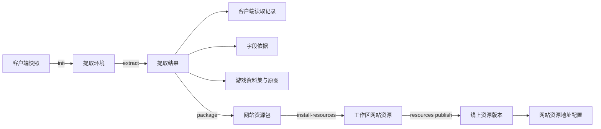

# 客户端资源提取

本工具从客户端快照提取资料、打包并安装网站资源。概念定义见[领域术语表](../../GLOSSARY.md#提取打包与本地安装)，维护决策及版本调查见[提取原理](docs/extraction-method.md)。

## 首次配置

先按[根 README](../../README.md#本地开发)安装依赖，并按其中的环境配置说明，在根目录 `.env` 中填写共享数据目录的绝对路径 `LOOMIX_DATA_ROOT`。准备支持平台上的客户端文件；支持平台以 [AnimeStudio 平台配置](src/client/anime-studio/config.ts)为准，首次准备工具需要网络、Git 与归档解压工具。

在仓库根目录导入并选择客户端；来源也可以是仓库外的绝对路径：

```sh
vp run @loomix/extraction#client -- import --source resources/game-client
vp run @loomix/extraction#client -- select --snapshot <snapshot-id>
```

使用导入命令打印的 snapshot ID。导入会校验并冻结客户端；新提取环境绑定所选快照，后续切换选择不会改变已有提取环境的输入。客户端更新时先按[提取原理](docs/extraction-method.md#客户端更新与调查)确认版本适配，再重新导入、选择，旧快照保留。

## 提取、打包与本地安装

以观星露营地为例，客户端读取记录保留玩法表中的座椅数量 3 和显示表中的 2。游戏资料集保留两种有不同含义的数量，字段依据记录各自来源。网站资源包把资料和布景配图一起交给网站，图片索引用于按用途找到配图文件。[业务确认与调查](docs/business-investigation.md#小栖地)



日常更新网站资源：

```sh
vp run @loomix/extraction#refresh
# 将 refresh 打印的 resource-package-id 填入下面的命令
vp run @loomix/extraction#verify --resource-package <resource-package-id>
vp run @loomix/extraction#install-resources --resource-package <resource-package-id>
```

`refresh` 依次准备提取环境、提取数据及原图、生成资源包。`verify` 核对实际客户端及整条产物链。`install-resources` 校验资源包后替换当前 worktree 的 `resources/website/`。已有共享资源包时，配置共享数据目录后可直接安装。

需要分阶段运行时，从帮助查看入口与参数：

```sh
vp run @loomix/extraction#refresh -- --help
```

帮助可在未准备工具时运行。各阶段使用各自的 ID。相对输入路径以仓库根目录为准。[CLI](src/cli.ts) · [共享数据契约](../../packages/schema/README.md#资料集图片与发布)

## 输入、缓存与产物

同机 worktree 共享 `LOOMIX_DATA_ROOT` 下的客户端、工具缓存和版本化产物；本地网站资源与临时调查文件各自独立。

| 位置                          | 用途                             |
| ----------------------------- | -------------------------------- |
| 共享根 `clients/`             | 只读客户端快照                   |
| 共享根 `cache/`               | 工具准备、昂贵批次恢复与失败诊断 |
| 共享根 `artifacts/`           | 封存的提取环境、提取结果与资源包 |
| worktree `resources/website/` | 当前网站读取的本地资源           |
| worktree `var/scratch/`       | 临时调查文件                     |

具体输出以各阶段清单的 `outputs` 为准。调查时从 `client-read-records.json` 查读取记录、排除项与候选，从 `field-evidence.json` 查最终字段依据。[提取原理](docs/extraction-method.md#按任务定位实现)

每个代码版本仅接受对应的提取阶段格式。遇到阶段清单版本不受支持时，从已选客户端快照运行 `refresh`，再使用新的阶段 ID 打包、验收或安装。旧产物可用生成它们的代码版本复验。客户端资源包的来源路径相对于该客户端快照根目录。

升级网站资源格式时，停止本工作区的安装和发布任务。若 `resources/website/` 中已有旧格式资源，先整体移到同文件系统的备份位置，恢复受跟踪的 `.gitkeep` 占位，再运行上述命令。若安装失败，可移回备份。

## 故障恢复与清理

失败后先查看命令错误及日志：工具准备日志在 `cache/anime-studio/logs/`，提取诊断在 `cache/failures/`，批次诊断在 `cache/decode/failures/` 和 `cache/originals/failures/`。修复原因后重跑；已完成且通过复验的昂贵批次可复用，不必先清空缓存。工具版本或下载失效时检查 [AnimeStudio 配置](src/client/anime-studio/config.ts)，显式更新固定版本与摘要，不自动跟随最新构建。

`install-resources` 替换本地资源失败时恢复旧目录。切换期间，本地资源可能短暂不可用。线上更新步骤见[CI/CD 与部署](../../DEPLOYMENT.md#资源更新流程)。

无运行任务时再清理失败的暂存目录、缓存或不再使用的产物。按资源包 ID 清理共享根 `artifacts/resource-packages/`，保留各 worktree 在用和计划用于回滚的资源包及其上游完整链。删除恢复缓存不会影响已有封存提取结果。客户端、共享缓存及产物、临时文件和日志均不提交。
